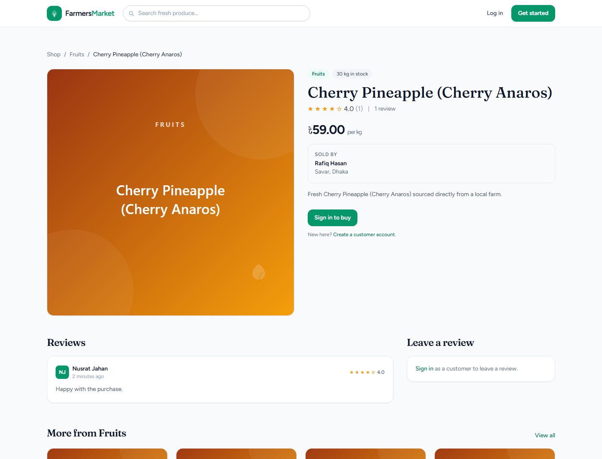
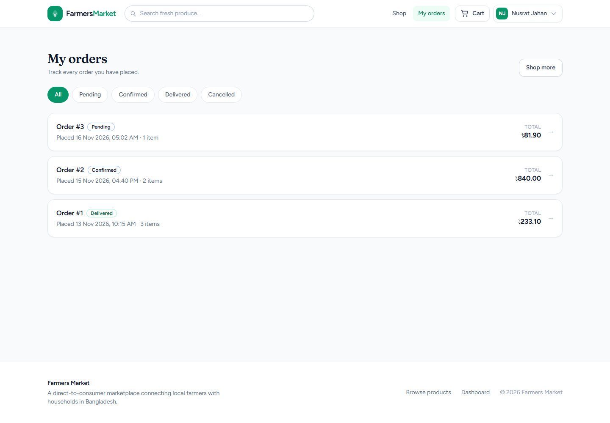
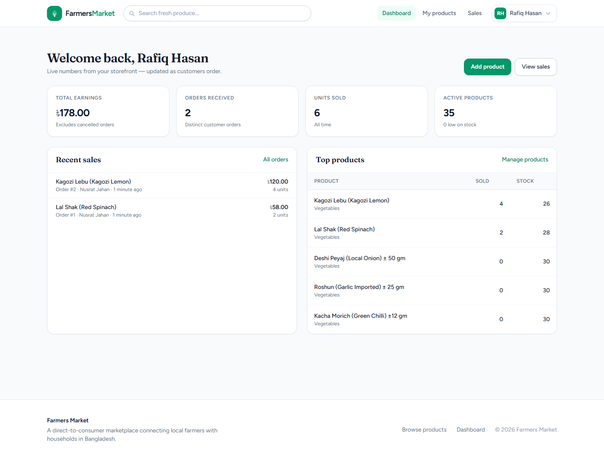
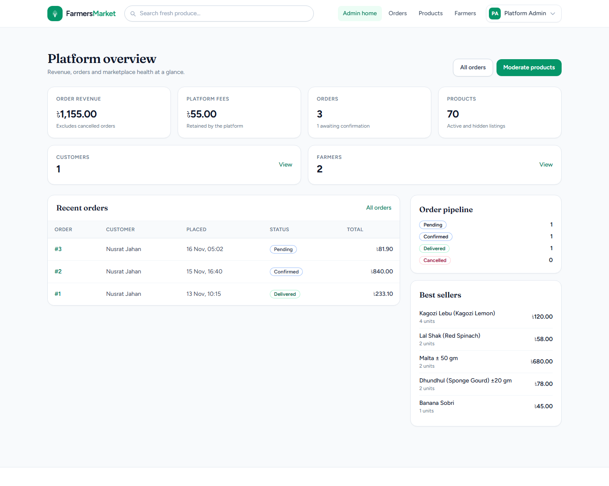
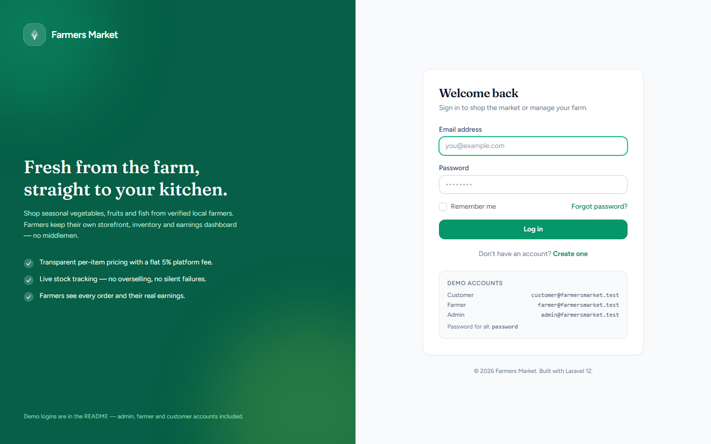

# Farmers Market — Farming Inventory Management System

A portfolio-ready rewrite of a legacy PHP/MySQL farming inventory system. Farmers list produce, customers shop and check out, and admins moderate the marketplace — all behind proper authentication, role-based access and transactional stock control.


## Why this rewrite

The original application worked, but it was unsafe and hard to maintain:

| Legacy problem | This rewrite |
| --- | --- |
| Plaintext admin password (`123`) and custom login scripts | Breeze authentication with hashed passwords and session protection |
| Random string IDs written into `int customer_id` columns | Typed users, foreign keys and role enums |
| String-concatenated SQL in delete handlers | Eloquent models and prepared statements throughout |
| Unvalidated uploads written to a public folder | Form requests validate images; files are stored on Laravel's public disk |
| 5% fee added cumulatively per cart row | Subtotal and platform fee calculated once per order |
| Broken includes and redirects (`product/index.php`, `login.php`) | Named routes, controllers and consistent redirects |
| No authorisation checks | Policies plus `role` middleware for customer, farmer and admin areas |

The original code is preserved in [`legacy/`](legacy/) (including `farming_inventory.sql`) for reference.

## Screenshots

| Storefront | Product page |
| --- | --- |
|  |  |

| Customer orders | Farmer dashboard |
| --- | --- |
|  |  |

| Admin dashboard | Sign in |
| --- | --- |
|  |  |

## Features

### Customers
- Browse, search, filter and sort 70 seeded products by category.
- Add to cart with live stock checks and a visible 5% platform fee.
- Checkout with delivery details, transactional stock reservation and an order history.
- Cancel pending/confirmed orders; cancelled stock is returned to farmers.
- Leave one review per purchased product.

### Farmers
- Role-protected dashboard with earnings, orders received, units sold and active listings.
- Create, edit, hide and remove their own products (ownership enforced by policy).
- Upload JPG/PNG/WebP product images (validated and stored privately on the public disk).
- See only their own order lines and payout details.

### Admins
- Marketplace overview: revenue, platform fees, order pipeline and best sellers.
- Moderate products: hide, publish, soft-delete and restore listings.
- Move orders through `pending → confirmed → delivered`, or cancel and restore stock.
- Browse farmers and customers.

## Tech stack

- **Laravel 12** (PHP 8.2+)
- **MySQL 8** (SQLite in-memory for tests)
- **Blade + Tailwind CSS + Alpine.js**
- **Vite** for assets
- **PHPUnit** for feature tests

## Getting started

### Option A — Docker with Laravel Sail

Requirements: Docker Desktop, Composer, Node.js.

```bash
cp .env.example .env
composer install
./vendor/bin/sail up -d
./vendor/bin/sail artisan key:generate
./vendor/bin/sail artisan migrate --seed
./vendor/bin/sail artisan storage:link
./vendor/bin/sail npm install
./vendor/bin/sail npm run build
```

Open <http://localhost:8000>. The example environment points the app at the `mysql` service and exposes MySQL on port `3307` so it will not clash with a local server.

On Windows PowerShell, use `vendor\bin\sail` instead of `./vendor/bin/sail`.

### Option B — Local PHP/MySQL

Requirements: PHP 8.2+ with `pdo_mysql`, MySQL/MariaDB, Composer, Node.js.

```bash
composer install
cp .env.example .env
# Edit .env for your local database:
#   DB_HOST=127.0.0.1
#   DB_USERNAME=root
#   DB_PASSWORD=
php artisan key:generate
php artisan migrate --seed
php artisan storage:link
npm install
npm run build
php artisan serve
```

The seeder creates 70 catalogue products, 15 reviews and three demo orders. Product thumbnails are generated locally as SVGs, so the app works without any external image CDN.

### Demo accounts

All accounts use the password `password`.

| Role | Email |
| --- | --- |
| Admin | `admin@farmersmarket.test` |
| Farmer | `farmer@farmersmarket.test` |
| Farmer | `ayesha@farmersmarket.test` |
| Customer | `customer@farmersmarket.test` |

## Testing

```bash
php artisan test
```

The suite covers registration and profile rules, role-based access (403s), cart stock limits, checkout totals and stock decrement, order cancellation/stock restoration, and admin status transitions.

## Project structure

```
app/
  Http/Controllers/      Home, product, cart, checkout, orders, farmer/*, admin/*
  Http/Requests/         Validation for products, checkout, bank details, reviews
  Models/                User, Farmer, Category, Product, Cart, Order, OrderItem, Review
  Policies/              ProductPolicy, OrderPolicy
  Services/              CartService, CheckoutService
  Support/               ProductPlaceholder (local SVG thumbnails)
database/
  migrations/            Full relational schema
  seeders/               Categories, demo users, 70 products, reviews, demo orders
resources/views/         Blade UI for every role
routes/web.php           Public, customer, farmer and admin route groups
legacy/                  Original PHP application and SQL dump
```

### Notes on correctness

- `CheckoutService` runs in a database transaction with row locks on the cart and products, re-checks stock, writes the order header/items and decrements stock atomically.
- Cancelling an order restores each line's quantity to the product, including soft-deleted products.
- Cart quantities are validated against current stock both when adding and when checking out.
- Deleting an account is refused when the user has order history, protecting the `restrictOnDelete` foreign key.

## License

MIT.
