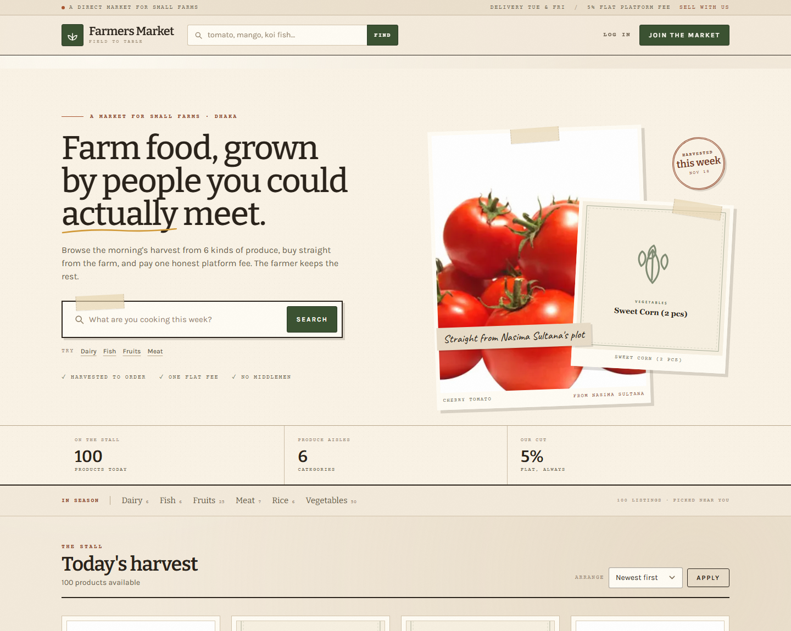

# Farmers Market

### A polished Laravel 12 marketplace for local farm produce

Farmers Market is a portfolio-ready rewrite of a legacy farming inventory application. It turns a basic catalogue into a complete multi-role marketplace where customers discover fresh produce, farmers manage their storefronts, and admins operate the platform.



[](https://laravel.com)
[](https://www.php.net)
[](#quality)
[](#license)

## Product tour

| Storefront | Product detail |
| --- | --- |
|  |  |

| Customer orders | Farmer dashboard |
| --- | --- |
|  |  |

| Admin dashboard | Sign in |
| --- | --- |
|  |  |

## What is included

### Customer experience

- Search, category filtering, sorting and responsive product cards.
- Farmer storefronts with farm name, location, bio and product listings.
- Product galleries with thumbnail navigation and responsive imagery.
- Session wishlist, recently viewed products and one-click **Buy again** reorder.
- Stock-aware cart with AJAX add, update and remove actions.
- Live mini-cart drawer, item badge and toast feedback without a page reload.
- Checkout with saved addresses, optional new address creation and payment method selection.
- Coupon codes with validation, discount limits and transactional usage tracking.
- Order timeline, cancellation rules, email notifications and in-app notifications.
- Downloadable PDF invoices with order QR codes.
- Customer reviews for purchased products.
- Mobile sticky add-to-cart bar and mobile filter drawer.

### Farmer workspace

- Public storefront for every farmer.
- Dashboard with 30-day sales chart, earnings, best sellers and low-stock alerts.
- Product create/edit workflow with up to five JPG, PNG or WebP gallery uploads.
- Spatie Media Library conversions: `thumb`, `card` and `full`, generated as WebP.
- Product ownership policies and farmer-only order visibility.
- Sales and catalogue CSV exports.
- Storefront profile and payout details.

### Admin workspace

- Revenue, fee, order and average-order-value overview.
- 30-day revenue chart, order status donut and top category analysis.
- Product moderation with hide, publish, soft-delete and restore actions.
- Customer, farmer, coupon and order management.
- Platform-wide order and product CSV exports.
- Low-stock email digest support and notification centre.

### Platform polish

- Breeze authentication with role-based access and policies.
- Transactional checkout with row locks, stock revalidation and status history.
- Accessible modal confirmations instead of browser `confirm()` dialogs.
- Skip link, live regions, keyboard-friendly dropdowns, labels and ARIA state.
- Canonical URLs, Open Graph/Twitter cards, Product JSON-LD, sitemap and robots routes.
- Mailpit-ready local email workflow.
- Seeded Bangladeshi produce catalogue with local WebP assets.

## Why this rewrite

The original application is preserved in [`legacy/`](legacy/) for comparison. The rewrite replaces the most fragile parts of the legacy system with a maintainable Laravel architecture:

| Legacy issue | Rewrite approach |
| --- | --- |
| Plaintext admin password and custom login scripts | Laravel Breeze authentication, password hashing and sessions |
| String-concatenated SQL | Eloquent models, relationships and prepared queries |
| Missing authorization checks | Policies plus role middleware for customers, farmers and admins |
| Unsafe upload handling | Form Request validation and Media Library conversions |
| Per-row fee calculation errors | Centralized cart totals and transactional checkout calculations |
| No stock audit trail | Locked stock reservation and `order_status_histories` |
| Inconsistent redirects and includes | Named routes, controllers, Blade components and services |

## Tech stack

- **Backend:** Laravel 12, PHP 8.2+, MySQL 8 / MariaDB
- **Frontend:** Blade, Tailwind CSS, Alpine.js, Vite
- **Authentication:** Laravel Breeze
- **Media:** Spatie Laravel Media Library, GD/WebP
- **Documents:** Dompdf and QR Code generation
- **Email:** Laravel Mail with Mailpit for local development
- **Testing:** PHPUnit 11, Laravel feature tests
- **Local development:** Laravel Sail / Docker or local PHP and MySQL

## Quick start

### Option A: Laravel Sail / Docker

Requirements: Docker Desktop, Composer and Node.js.

```bash
cp .env.example .env
composer install
./vendor/bin/sail up -d
./vendor/bin/sail artisan key:generate
./vendor/bin/sail artisan migrate --seed
./vendor/bin/sail artisan storage:link
./vendor/bin/sail npm install
./vendor/bin/sail npm run build
```

Open <http://localhost>. Mailpit is available at <http://localhost:8025>.

On Windows PowerShell, use `vendor\\bin\\sail` instead of `./vendor/bin/sail`.

### Option B: Local PHP and MySQL/MariaDB

Requirements: PHP 8.2+ with `pdo_mysql`, `gd`, `exif`, `intl` and `zip`, Composer, Node.js, and MySQL/MariaDB.

```bash
composer install
copy .env.example .env
php artisan key:generate
```

Configure the database in `.env`, then run:

```bash
php artisan migrate --seed
php artisan storage:link
npm install
npm run build
php artisan serve
```

Open <http://127.0.0.1:8000>.

For local email inspection, set `MAIL_MAILER=log` for a simple log-only setup, or run Mailpit through Sail and use its SMTP settings from `.env.example`.

### Demo accounts

All seeded accounts use the password `password`.

| Role | Email |
| --- | --- |
| Admin | `admin@farmersmarket.test` |
| Farmer | `farmer@farmersmarket.test` |
| Farmer | `ayesha@farmersmarket.test` |
| Customer | `customer@farmersmarket.test` |

Seeded coupon codes include `FRESH10`, `FLAT50` and `BULK15`.

## Useful commands

```bash
# Run the complete test suite
php artisan test

# Format changed PHP files
vendor/bin/pint --dirty

# Build production frontend assets
npm run build

# Inspect routes
php artisan route:list

# Rebuild the database and demo catalogue
php artisan migrate:fresh --seed
```

## Quality

The current Tier 4 baseline is green:

- **142 tests passing**
- **487 assertions**
- Laravel Pint clean
- Vite production build successful
- Browser homepage smoke check completed with no console errors

The feature suite covers authentication, role access, carts, AJAX cart payloads, coupons, checkout, stock control, order history, notifications, invoices, addresses, wishlist, reorder, media galleries, dashboards, CSV exports and SEO routes.

## Project structure

```text
app/
  Http/Controllers/       Public, customer, farmer, admin and export endpoints
  Http/Requests/           Input validation and authorization
  Models/                  Users, farmers, products, carts, orders and media
  Policies/                Product and order ownership rules
  Services/               Cart, checkout, coupon, wishlist and reorder logic
  Support/                 CSV, QR and placeholder helpers
  View/Components/         Reusable Blade layout components

database/
  migrations/              Relational schema and order audit trail
  seeders/                 Demo users, catalogue, galleries, coupons and orders

resources/
  js/app.js                Alpine cart store and AJAX interactions
  views/                   Accessible Blade interface for every role

routes/web.php             Public, customer, farmer and admin routes
tests/Feature/             End-to-end HTTP and workflow coverage
legacy/                    Original PHP application and SQL dump
docs/screenshots/          Portfolio screenshots
```

## Correctness and security notes

- Checkout runs inside a database transaction and locks cart/product rows while rechecking stock.
- Order status changes are recorded in an immutable status-history table.
- Cancelling an order restores quantities, including soft-deleted products.
- Customers can only access their own orders, addresses, wishlist and invoices.
- Farmers can only modify their own products and see their own order lines.
- Account deletion requires password confirmation and is blocked when order history would violate referential integrity.
- Media uploads are MIME/type/size validated before conversion.

## License

MIT.
